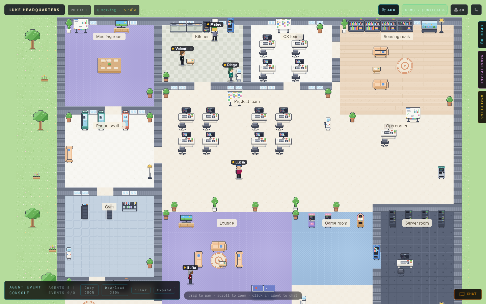
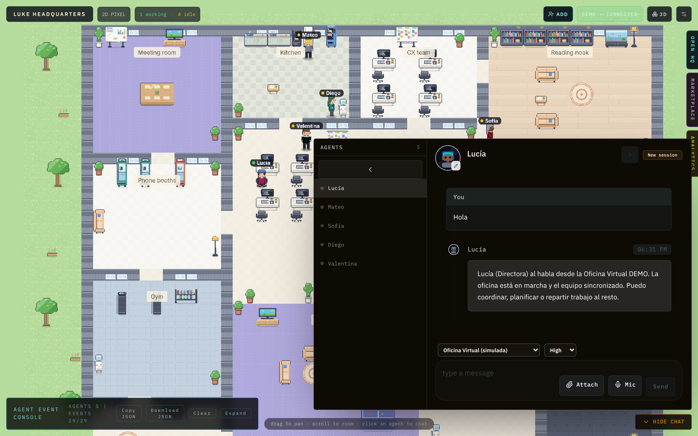

# Oficina Virtual DEMO · Hermes3D

Oficina virtual de demostración construida sobre
[Hermes3D](https://github.com/iamlukethedev/Hermes3D): una oficina en 3D / 2D
pixel-art donde los agentes de IA aparecen como trabajadores que se mueven,
se sientan en sus mesas y responden por chat.

**Es una DEMO**: no hay ningún modelo de IA conectado. Un gateway simulado
(`gateway/oficina-demo-gateway.js`) responde en español con mensajes
predefinidos para poder explorar la oficina sin instalar nada más.



## Abrirla desde el móvil (sin PC) con GitHub Codespaces

[](https://codespaces.new/chrisxu7/chrisxu7/tree/claude/hopeful-archimedes-8b6snv)

1. En el navegador del móvil (con tu sesión de GitHub iniciada), abre
   <https://codespaces.new/chrisxu7/chrisxu7/tree/claude/hopeful-archimedes-8b6snv>
   y pulsa **Create codespace**. Si la página sale incompleta, activa
   "Vista de ordenador" en el menú del navegador.
2. Espera a que termine de prepararse: la primera vez instala y compila
   Hermes3D (unos 5–10 minutos). La oficina arranca sola al final.
3. Abre la pestaña **Puertos / Ports** (en el menú ☰ → Terminal → Ports o
   tocando el icono de antena de la barra inferior) y pulsa el globo 🌐 del
   puerto **3000 · Oficina Virtual**. También puedes ver la dirección en el
   terminal con `cat .oficina-url`. Tiene esta forma:
   `https://<nombre-del-codespace>-3000.app.github.dev/office`
4. Ese enlace solo funciona con tu cuenta de GitHub (es privado). Si quieres
   compartirlo, en Ports → clic derecho/mantener pulsado → *Port visibility* →
   *Public*.

Si la oficina no aparece, en el terminal del Codespace ejecuta
`cat /tmp/oficina.log` para ver el registro, o arráncala a mano con
`./scripts/oficina-demo.sh`.

Codespaces es gratuito hasta 120 horas-núcleo al mes en cuentas personales.
Cuando acabes, detén el Codespace (github.com/codespaces → ⋯ → *Stop*) para no
gastar horas.

## El equipo

| Agente | Rol | |
|---|---|---|
| Lucía | Directora | 🧭 |
| Mateo | Investigación | 🔎 |
| Sofía | Desarrollo | 🛠️ |
| Diego | Diseño | 🎨 |
| Valentina | QA | ✅ |

Para cambiar nombres, roles o respuestas edita [`gateway/equipo.json`](gateway/equipo.json)
y reinicia el script. También puedes añadir agentes desde el botón **ADD** de la
oficina (se pierden al reiniciar, porque la demo no guarda nada).

## Cómo arrancarla en tu ordenador

Requisitos: **Node.js 22** (mínimo 20), **npm** y **git**.

```bash
./scripts/oficina-demo.sh
```

La primera vez el script:

1. Descarga Hermes3D (commit fijado) en `.hermes3d/`.
2. Instala sus dependencias y lo compila (tarda unos minutos).
3. Arranca el gateway demo en `ws://localhost:18789`.
4. Arranca Hermes3D Studio en <http://localhost:3000>, ya conectado al gateway en modo **Demo**.

Abre <http://localhost:3000/office>. Las siguientes veces arranca en segundos.
`Ctrl+C` cierra todo.

Opciones:

- `--rebuild` recompila Hermes3D (por ejemplo, tras cambiar `HERMES3D_REF`).
- `--dev` usa el modo desarrollo de Next.js (para tocar el código de Hermes3D).
- `--preparar` solo descarga, instala y compila, sin arrancar nada.
- Variables: `PORT` (Studio, 3000), `DEMO_ADAPTER_PORT` (gateway, 18789),
  `OFICINA_NOMBRE`, `OFICINA_EQUIPO` (otro JSON de equipo), `HERMES3D_REF`.

## Uso rápido

- La primera vez aparece el asistente de bienvenida de Hermes3D: ciérralo con la **X**
  (la conexión ya está hecha; arriba a la derecha verás `DEMO • CONNECTED`).
- **CHAT** (abajo a la derecha) o clic en un agente para hablar con él. Prueba con "Hola".
- Botón **3D / 2D PIXEL** de la barra superior para cambiar de vista.
- **OPEN HQ**, **MARKETPLACE** y **ANALYTICS** en el lateral derecho.



## Pasar de DEMO a agentes reales

Cuando quieras agentes de verdad, sustituye el gateway demo por el adaptador de
Hermes (`npm run hermes-adapter` dentro de `.hermes3d/`) o por un runtime
propio. Consulta el [README de Hermes3D](https://github.com/iamlukethedev/Hermes3D#quick-start)
y su [tutorial](https://github.com/iamlukethedev/Hermes3D/blob/main/TUTORIAL.md).

## Créditos

Hermes3D es © 2026 Luke The Dev, licencia MIT. `gateway/oficina-demo-gateway.js`
es una adaptación de su `server/demo-gateway-adapter.js` (misma licencia).
